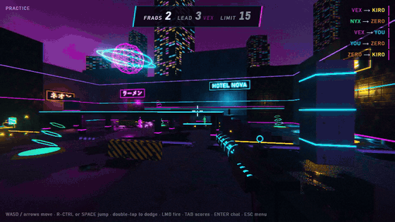

# Instagib Duel

**▶ Play now: https://stekhub.github.io/instagib-duel/**

A fast multiplayer arena shooter that runs in the browser. Every shot kills, first to the frag limit wins. No install, no account, no server. The whole game is a single 140 KB HTML file.



## How to play

1. Open the [game page](https://stekhub.github.io/instagib-duel/), enter a player name and press **Play online**.
2. You land in a lobby with everyone else who is playing. A match starts automatically 15 seconds after a second player joins.
3. Or press **Practice vs bots** to play offline against four bots.

| Key | Action |
|---|---|
| WASD / arrow keys | Move |
| Mouse | Aim |
| Left mouse button | Fire |
| Space / right Ctrl | Jump |
| Double-tap a direction | Dodge |
| Tab | Scoreboard |
| Enter | Chat |
| Esc | Menu |

## Rules

- **Instagib:** everyone carries the same railgun, and one hit kills. There is no health and there are no pickups, only aim and movement.
- The railgun recharges in 0.9 seconds after each shot.
- You respawn 1.8 seconds after dying, at the spawn point farthest from the player who killed you.
- The first player to reach the frag limit wins (5, 10, 15, 25 or 40; the host chooses, default 15).
- After a match, the results show for 10 seconds, then everyone returns to the lobby and the next match starts on its own.
- Up to 6 players per lobby.

## Features

### Gameplay
- Fast arena movement: ground friction, low air control, jumps, dodge jumps and step-up onto low ledges.
- Jump pads that launch you onto bridges and balconies.
- A two-level arena: the "Sector 9" rooftop market at night, with containers, bridges, balconies and stalls.
- Hitscan railgun with a visible beam, an impact flash, gibs on a kill and a shimmer on respawn.
- Every player glows in their own colour, so you can spot them against the dark level.
- Practice mode against four bots that roam the arena along a navigation graph, hop around and shoot every 1.3 to 2.9 seconds, hitting about a quarter of their shots.

### Multiplayer
- **Automatic matchmaking with no server of our own.** Everyone who presses Play ends up in the same lobby. When it is full, the game moves on to the next one.
- **Late joining:** players can join a match that is already running.
- **Host leaves? The game goes on.** The remaining players regroup within about two seconds and one of them becomes the new host.
- **Chat** with Enter, shown in the bottom left.
- **Mute** a player (only for you) and, as host, **kick** them. A kicked player's address is refused by the host for 24 hours.
- **Anti-cheat** run by the host (see below).

### Presentation
- Neon cyberpunk look: wet asphalt with puddles, glowing signs in English and Japanese, a skyline with lit windows and optional rain (off by default, switch it on in Options).
- Bloom, filmic tone mapping, colour grading, soft shadows, reflections and chromatic aberration.
- A techno/metal soundtrack and all sound effects are synthesized live in the browser. Two tracks to choose from.
- Options for rain, music, fullscreen and graphics quality. Fullscreen can also be switched from the in-game menu. The game switches to low graphics by itself when the frame rate stays low.

## How it works

### One file, no assets
`index.html` contains the whole game: markup, styles and about 2,000 lines of JavaScript. It loads only two libraries from a CDN: [three.js](https://threejs.org/) 0.160 for 3D rendering and [PeerJS](https://peerjs.com/) 1.5.4 for networking. There are no image, model or audio files. Everything is generated when the page loads.

### Graphics
- **Level geometry** is built from boxes in code. Each box has a material, and solid boxes double as collision volumes for the physics.
- **Textures** are small GLSL programs (asphalt, concrete, metal, tread plate, hazard stripes, containers and windows). Each one is rendered once on the GPU into colour, roughness/metalness and normal maps at 1024×1024, using tileable noise and Voronoi patterns.
- **Signs** are drawn on a 2D canvas and used as glowing textures.
- **Characters** are assembled from simple shapes (armour plates, limbs, helmet, railgun) and animated in code: legs that run, strafe and tuck in the air, a body that leans into movement, and head and gun that follow where the player aims.
- **Lighting:** a moonlight with soft shadows, neon strip lights and lamps, and reflections from a cube map that captures the finished arena once at load time.
- **Post-processing:** the scene is rendered in HDR, then bloom, an ACES tone curve and a colour grade (teal shadows, magenta highlights), with chromatic aberration that gets stronger when you die.
- **Two quality levels.** Low turns off shadows, anti-aliasing and most of the rain, and renders at a lower resolution. If the game runs below 40 fps for 8 seconds in a match, it switches to Low and says so in the chat.

### Sound and music
Everything you hear is made with the Web Audio API. Gunshots, jumps and deaths are short combinations of oscillators, noise and filters. The music comes from a small sequencer with drums, bass, a distorted double-tracked guitar through a simulated amp, and synth leads. It schedules notes slightly ahead of time so they stay in time even when the game is busy, and the drums briefly lower the other instruments on each kick so the mix pumps like dance music.

### Networking
- **Peer-to-peer over WebRTC.** PeerJS's free public server only introduces the players to each other. After that, all game data goes directly between browsers.
- **Host and guests.** The first player in a lobby becomes the host. Guests send their own position and shots to the host. The host decides kills and keeps the score, and sends everyone's state to everyone 30 times a second.
- **Matchmaking.** The lobby names are fixed (`…-0`, `…-1`, …). Pressing Play tries to *claim* lobby 0 on the PeerJS server. If that works, you are the host; if the name is taken, you join whoever holds it. A full lobby, a lobby that does not answer within 10 seconds, or a host that has kicked you sends you on to the next number.
- **Smooth movement.** Other players are drawn slightly in the past, between the last two updates received. The size of that buffer adapts to each player's connection: about 60 ms on a steady link, up to 250 ms on bad Wi-Fi. Uneven arrival times are evened out so movement stays smooth.
- **Hit detection.** The shooter's browser decides whether a shot hit, so what you see is what you hit, even with lag. The host then checks the claim (see below) before it counts.

### Anti-cheat
Anyone can edit the HTML file, so the host checks everything a guest sends:

- **Movement:** teleporting, running faster than the game allows, flying, hovering, going higher than any jump pad can throw you, and standing inside walls.
- **Shooting:** fire rate (a burst of up to 3 queued shots is allowed after a lag spike), and whether a hit is plausible. The shot must start at the shooter, the target must have been at that spot within the last 2.5 seconds, and there must be a clear line of sight.
- **Respawning:** respawning too early or away from a spawn point.

A player who breaks a rule is first moved back to their last legal position. Five violations within a minute, or sustained rapid fire, gets them kicked. Violations are logged in the host's browser console as `[anti-cheat] NAME: reason`.

The design goal was **no false positives**. The checks were tested with an automated honest player at 12 fps, with heavy jitter and with 1.8-second network freezes, without a single flag. Each check was also tested against a scripted cheater.

**Limitation:** the host is trusted. A cheating host cannot be detected, because there is no independent server to check them.

### Chat safety
Chat messages are only ever displayed as plain text, never as HTML, so nobody can inject code. Invisible and text-direction control characters are removed, messages are limited to 120 characters, the host limits how often each player can send, and the host stamps the real sender on every message, so nobody can speak in someone else's name.

## Running it locally

Serve the folder with any static web server and open `index.html`, for example:

```
python -m http.server 8000
```

Then open http://localhost:8000. Opening the file directly from disk may not work because browsers restrict modules loaded from `file://` pages.

## Support

If you like the game, please ⭐ star the repo and check out my other projects at [github.com/stekhub](https://github.com/stekhub/).

## License

[MIT](LICENSE)
